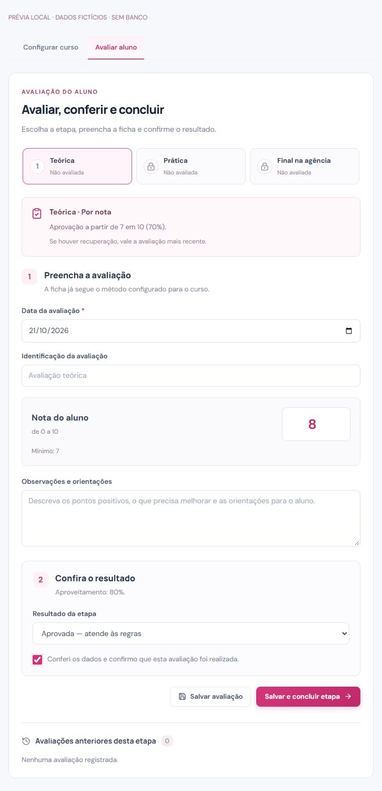

# Avaliação dos alunos — operação e entrega

## Preparação dos acessos

O Otavio permanece administrador. Em **Equipe e acessos**, ele pode criar ou vincular o cadastro de cada profissional, escolher **Coordenadora**, **Professora teórica** ou **Professora prática** e atribuir as turmas correspondentes. Não basta existir na tabela de usuários do ERP: o perfil do módulo precisa estar ativo. As professoras recebem somente as turmas atribuídas e avaliam apenas sua etapa. A coordenadora gerencia admissões, matrículas e encerramento.

## Como o Otavio configura

1. Acesse **Gestão de Cursos**, abra o curso e selecione **Avaliação**.
2. Informe o padrão de aprovação. **0 dispensa a nota mínima**; vazio mantém o mínimo da turma.
3. Marque as etapas necessárias: **Teórica**, **Prática**, **Final na agência**. A sequência segue essa ordem; etapas desmarcadas não são exigidas.
4. Em cada etapa, escolha:
   - **Por nota:** prova ou atividade com nota de 0 a 10 ou 0 a 100.
   - **Por habilidades:** habilidades observadas e parecer escrito, sem nota numérica.
   - **Nota e habilidades:** combina a nota com habilidades e parecer.
5. Defina o mínimo de cada etapa, se diferente do padrão. É possível usar 70% na teoria e 0% na final, por exemplo; esses valores são decisões do administrador.
6. Escolha entre **avaliação mais recente** (inclui recuperação) e **média das avaliações**.
7. Adicione as habilidades definidas pelas professoras. Para aprovação, todas devem estar como **Atende ao esperado**. **Precisa melhorar** e **Não atende** mantêm pendências.
8. Confira o resumo e clique em **Salvar alterações**.

A sugestão para cuidadores é opcional, editável e só é aplicada quando o curso é salvo. Não impõe um percentual. As matrículas já iniciadas preservam suas regras: editar o curso não muda retroativamente a avaliação desses alunos.

## Como a professora avalia

1. Entre com seu próprio usuário, abra uma turma atribuída e clique em **Abrir avaliação** no aluno.
2. A ficha mostra a etapa, o método, a escala e o mínimo da matrícula.
3. Preencha os campos apresentados. No método por nota, a nota deve ser informada mesmo quando o mínimo é zero; **nota zero é válida nesse caso**. No método por habilidades, registre as observações e o parecer.
4. Confira o aproveitamento e as pendências exibidas na própria ficha.
5. Use **Salvar avaliação** para guardar o registro sem liberar a etapa seguinte.
6. Para finalizar, marque a confirmação e clique em **Salvar e concluir etapa**.

O resultado automático é **Aprovada** quando as regras estão satisfeitas; caso contrário, é **Em recuperação**. A professora também pode registrar recuperação ou reprovação com parecer justificativo. A aprovação da etapa anterior libera a seguinte. A etapa final é lançada pela administração/coordenação.

### Recuperação e correção

- **Nova avaliação** cria outro registro, preservando os anteriores. O cálculo segue a opção configurada para a matrícula.
- **Corrigir** altera um registro existente com auditoria. A professora só corrige os próprios lançamentos de sua etapa e turma.
- Alterar uma avaliação reabre a etapa e invalida as aprovações posteriores, que precisam ser conferidas novamente. As notas históricas dessas etapas são preservadas.
- Um certificado ativo impede alterações nas avaliações. É necessário cancelar o certificado com justificativa antes de corrigir e emitir uma nova via.

## Chamada e encerramento

- As áreas teórica e prática oferecem **Chamada e frequência** nas turmas atribuídas. A coordenação encontra a mesma ficha na gestão da turma.
- Justificativa e reposição têm campo de texto e salvamento explícito por aluno.
- O percentual considera aulas realizadas, já encerradas, não canceladas e posteriores à matrícula. Falta justificada conta como ausência; reposição conta como presença.
- A coordenação acessa **Vínculos e Notas → Resumo e resultado → Concluir com aprovação**. O servidor confere etapas, avaliações e frequência antes de liberar o certificado.
- Aptidão profissional é registrada pela coordenação no perfil do aluno, separadamente da aprovação acadêmica.

## Consulta do aluno

O aluno pode consultar etapas, notas, pareceres, habilidades observadas e frequência por aula. Os links de comprovante e histórico permitem impressão/salvamento em PDF pelo navegador. O certificado tem QR Code para validação pública. Os dados impressos do certificado são preservados na emissão e usados também na validação pública.

## Verificações executadas

- `npm test`: **29 testes aprovados**, cobrindo cadastro, CSV, máscaras, módulos de aulas, QR, regras de avaliação, assinatura de tokens, perfis desativados e versões de sessão.
- `npm run verify:assessment`: serviços reais no SQL Server, dentro de transação revertida. Verifica sequência, autorização negativa de docente sem turma, escala, aprovação inválida, gravação conjunta de nota/etapa, congelamento das regras, frequência/justificativa/reposição, certificado ativo, correção e auditoria. Confere que as contagens de linhas voltam ao estado anterior.
- `npm run build`: compilação de produção e tipos.
- Inspeção dos componentes reais no navegador, com dados fictícios isolados do banco: nota 8/10, aprovação/liberação da prática e adaptação para celular de 390 px. A prévia não autentica usuários e não representa homologação de login com contas reais.

## Limites da afirmação “100% pronto”

O fluxo funcional descrito acima foi implementado. A aceitação final exige a operação com as contas reais que o Otavio criará e a publicação no ambiente de destino. Não foram criadas contas de professoras sem identificação das pessoas.

Mantém-se a logo solicitada em `public/logo01.svg`. Não há upload arbitrário de logo ou anexos: o módulo de documentos registra um checklist de recebimento. A impressão de PDF usa o navegador. O acesso legado do Otavio permanece compatível com o ERP; não foi feita uma migração indiscriminada das senhas do SoftCare.

O Next.js foi atualizado da série 14 para a série 15 corrigida, com parâmetros/cookies assíncronos. O PostCSS foi unificado na versão corrigida. Ainda existem alertas do npm na cadeia de ferramentas do Tailwind 3; a migração para Tailwind 4 não está incluída nesta alteração de avaliação. Não apresentar esta entrega como auditoria integral de segurança sem pendências.

Referência técnica da migração: [documentação oficial do Next.js 15](https://nextjs.org/docs/app/guides/upgrading/version-15).

